# LBAudio plugins

Mixing, mastering and effects plugins, and a sampler, by LBAudio, built with [JUCE 8](https://juce.com).
Each builds as **VST3** on Windows, macOS and Linux, and also as **Audio Unit** on macOS (for Logic / GarageBand).

| | Plugin | What it is |
|---|---|---|
| 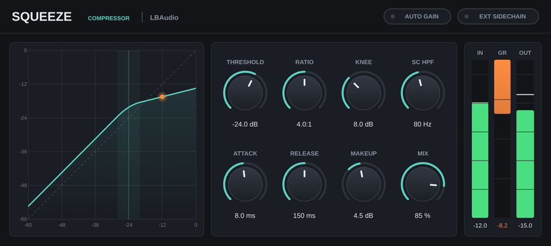 | **Squeeze** | Clean, zero-latency compressor with sidechain, parallel mix and auto makeup |
| 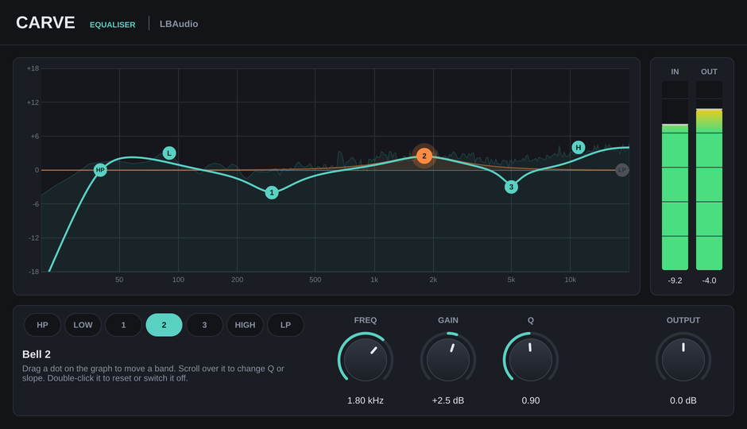 | **Carve** | 7-band EQ with a live spectrum analyser you can drag bands around on |
| 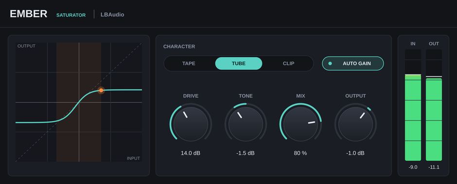 | **Ember** | Saturator: tape, tube and clip characters, 16x oversampled |
| 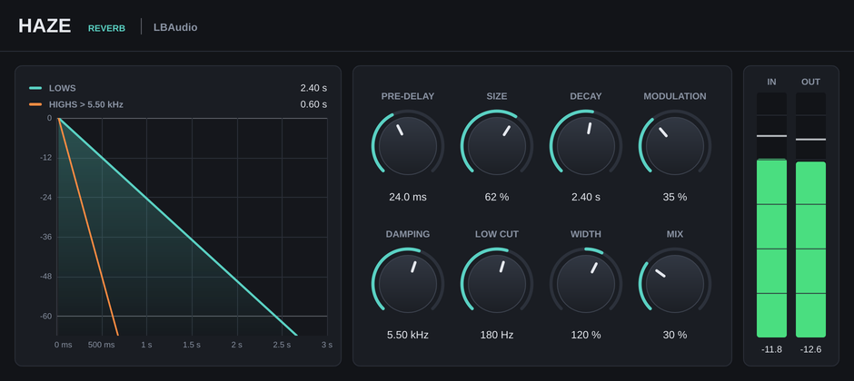 | **Haze** | Algorithmic reverb with an exact decay time and a display of how it dies away |
| 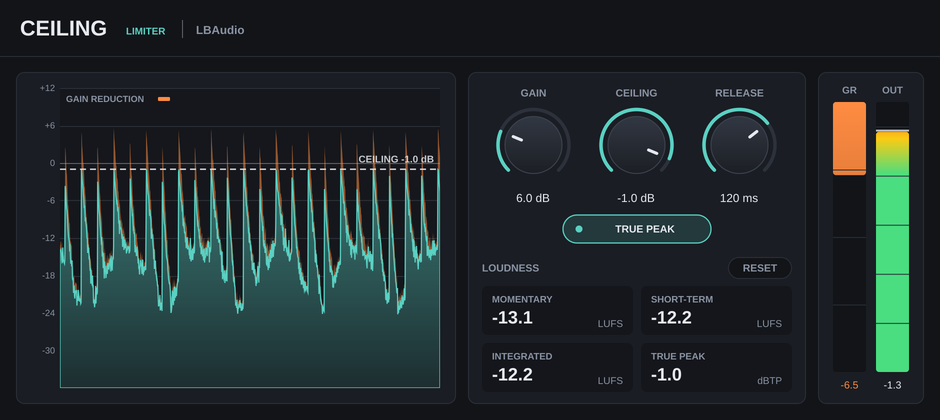 | **Ceiling** | True-peak limiter with LUFS loudness metering |
| 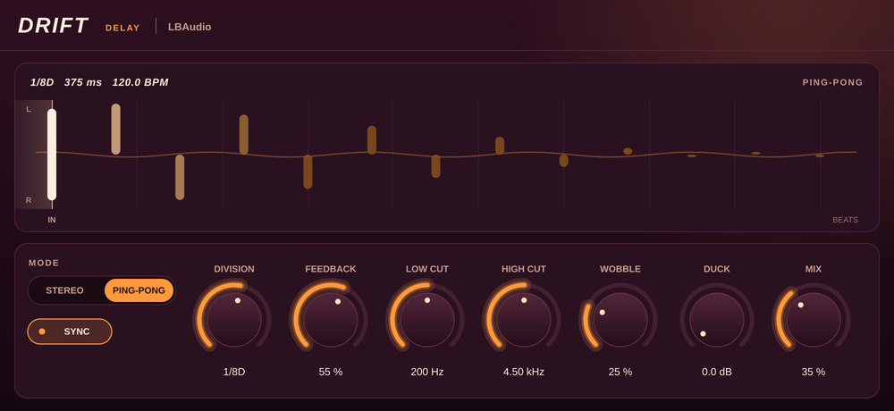 | **Drift** | Tempo-synced tape delay: ping-pong, darkening repeats, wobble and ducking |
| 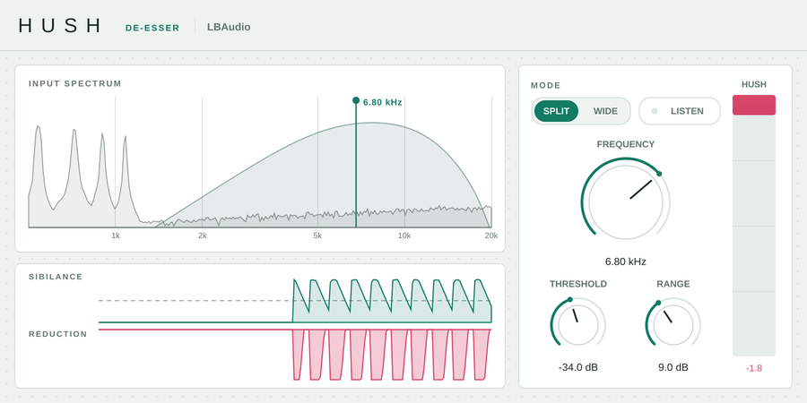 | **Hush** | De-esser: split or wideband, with a listen mode and a history of every S it caught |
| 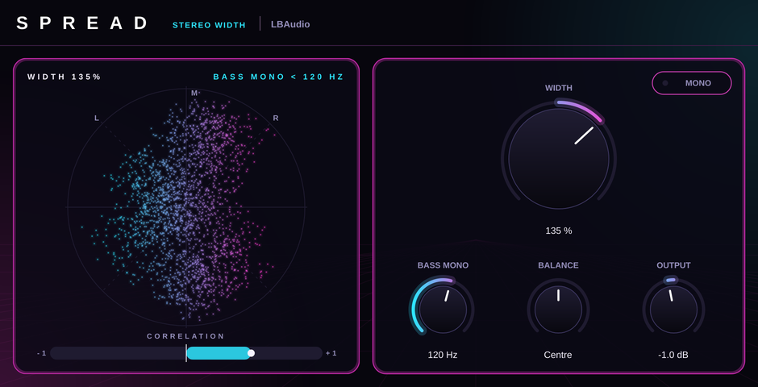 | **Spread** | Stereo width with bass mono, a mono check and a vectorscope |
| 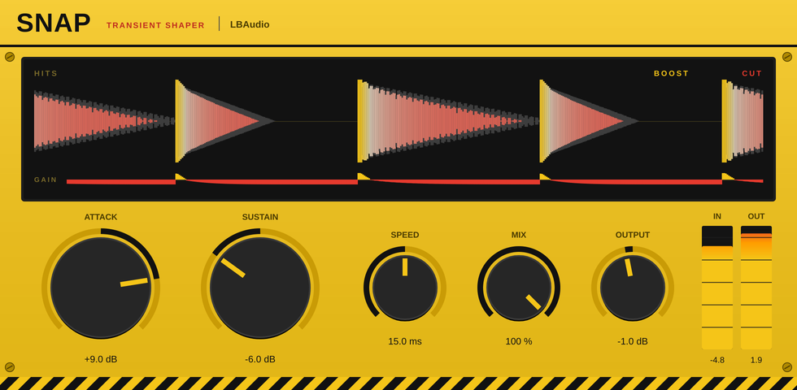 | **Snap** | Transient shaper: level-independent attack and sustain |
| 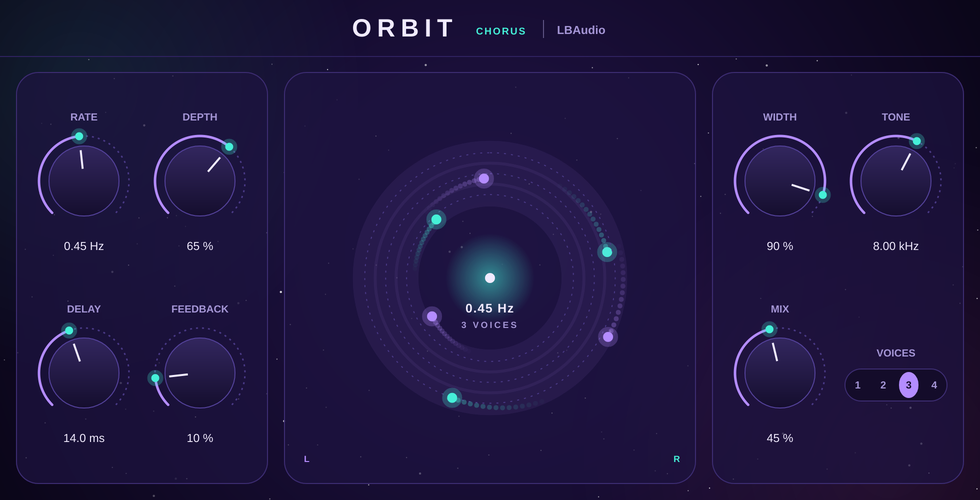 | **Orbit** | Stereo chorus with up to four voices, shown orbiting on screen |
| 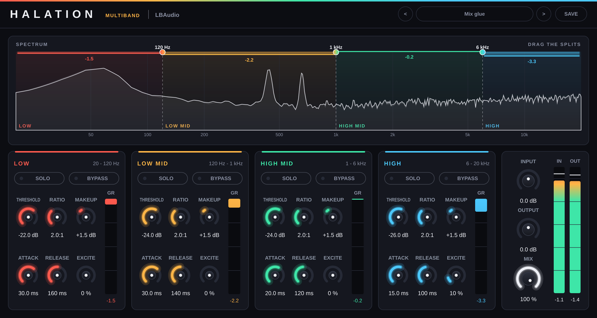 | **Halation** | Four-band compressor with an exciter in every band (five tones, with a mix), factory presets and your own |
| 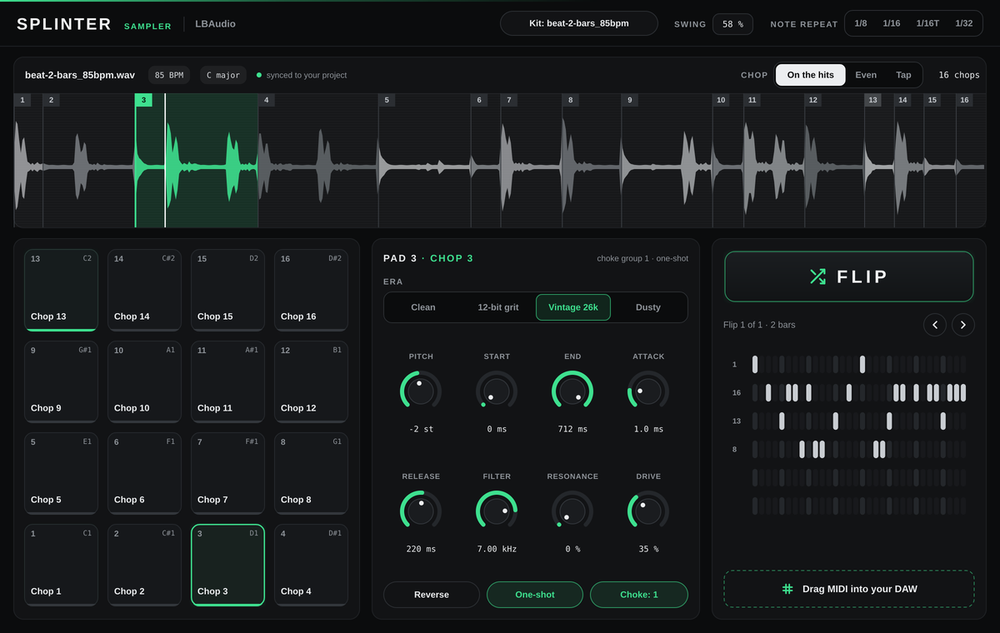 | **Splinter** | Sampler instrument: chops a sample on the hits across 16 pads, Eras, note repeat, and Flip patterns you drag out as MIDI |

The first five share the house look; Drift, Hush, Spread, Snap, Orbit and Halation each have their own (themes in `shared/LBAudio/UI.h`), and so does Splinter (in its editor).
All of them: double-click a knob to reset it; click a value to type one in (`1.2 s`, `250 ms`, `4k`, `off` all work).

## The plugins

### Squeeze (compressor)

| Control | Range | What it does |
|---|---|---|
| Threshold | −60 … 0 dB | Level above which compression starts |
| Ratio | 1:1 … 20:1 | How hard signal above the threshold is reduced |
| Knee | 0 … 24 dB | Width of the soft transition around the threshold (0 = hard knee) |
| SC HPF | Off … 500 Hz | High-pass on the detector only, so bass doesn't cause pumping |
| Attack / Release | 0.1 … 200 ms / 5 ms … 2 s | How fast gain reduction starts and recovers |
| Makeup | −12 … +24 dB | Output gain (or Auto Gain sets it from threshold and ratio) |
| Mix | 0 … 100 % | Parallel compression. 0 % is bit-identical to the input |
| Ext Sidechain | on/off | Detect from the sidechain input, e.g. kick ducking a bass |

A stereo-linked peak detector feeds a soft-knee gain computer with attack and release smoothed in the dB domain (Giannoulis, Massberg & Reiss, JAES 2012). Zero latency.

### Carve (EQ)

Seven bands: high-pass, low shelf, three bells, high shelf, low-pass, plus Output (±18 dB).

| Band | Frequency | Gain | Also |
|---|---|---|---|
| High-pass / Low-pass | 10 Hz – 1 kHz / 1 – 22 kHz | | On/off; slope 12, 24 or 48 dB/oct |
| Low shelf / High shelf | 20 Hz – 1 kHz / 1 – 20 kHz | ±18 dB | |
| Bell 1–3 | 20 Hz – 20 kHz | ±18 dB | Q 0.1 – 18 |

Drag a node to set frequency and gain, scroll to change Q (or the slope of the pass filters), double-click to reset gain or switch a pass filter on and off. The curve drawn is computed from the same filters that process the audio, behind a live spectrum of the signal. Parameters glide in the log domain, so automation is smooth. Zero latency.

### Ember (saturator)

| Control | Range | What it does |
|---|---|---|
| Character | Tape / Tube / Clip | Tape: smooth, odd harmonics. Tube: asymmetric, adds even harmonics. Clip: firm knee |
| Drive | 0 … 36 dB | How hard the signal hits the curve |
| Tone | ±6 dB | Tilt EQ around 1 kHz, after the saturation |
| Mix | 0 … 100 % | Parallel saturation (the dry path is delayed to stay in phase) |
| Output | −24 … +12 dB | Output level |
| Auto Gain | on/off | Keeps the level about the same as you change Drive |

The curve runs at 16x the sample rate, so aliasing stays below −90 dB even for a hard-driven 9 kHz tone. Latency: 67 samples, reported to the DAW.

### Haze (reverb)

| Control | Range | What it does |
|---|---|---|
| Pre-delay | 0 … 200 ms | Gap before the reverb starts |
| Size | 0 … 100 % | How big the space is |
| Decay | 0.2 … 20 s | Time for the tail to fall 60 dB (RT60) |
| Modulation | 0 … 100 % | Slow movement in the tail, which smooths out metallic ringing |
| Damping | 1 … 20 kHz | Above this frequency the tail dies away four times faster |
| Low Cut | 20 Hz … 1 kHz | Keeps low end out of the reverb |
| Width | 0 … 200 % | Stereo spread of the reverb (0 % = mono) |
| Mix | 0 … 100 % | Dry/wet balance (equal-power). 0 % is bit-identical to the input |

An 8-line feedback delay network with a 4-step diffuser. Each line's gain is set from its length, so the measured decay time matches the knob (within 3 %) at every size. Damping is a shelf in each loop, so it sounds the same at every size and decay. Zero latency; mono in, stereo out works.

### Ceiling (limiter)

| Control | Range | What it does |
|---|---|---|
| Gain | 0 … 24 dB | Pushes the level into the limiter |
| Ceiling | −12 … 0 dB | The output never goes above this |
| Release | 1 ms … 1 s | How quickly the level recovers after a peak |
| True Peak | on/off | Also catches peaks between samples, which clip in converters and MP3/AAC encoders |

Readouts: momentary, short-term and integrated loudness (LUFS, ITU-R BS.1770-4 / EBU R128 with gating) and the true-peak maximum (dBTP); **Reset** restarts them. The graph shows the level going in and coming out over the last few seconds, with the gain reduction in amber.

2 ms lookahead: the gain is held and smoothed so it has fully arrived before each peak, with no clipping involved. True-peak detection takes the larger of an 8x interpolator and the BS.1770 meter filter, so standard true-peak meters read at or under the ceiling. Latency: 2 ms plus 16 samples (111 samples at 48 kHz), reported to the DAW.

### Drift (delay)

| Control | Range | What it does |
|---|---|---|
| Time | 1 ms … 2 s | The delay time when Sync is off |
| Sync / Division | 1/32 … 1/1, with triplets and dotted | Locks the echoes to the project tempo (120 BPM if the host doesn't give one) |
| Feedback | 0 … 95 % | How much of each echo comes round again |
| Mode | Stereo / Ping-pong | Ping-pong bounces the echoes left, right, left… |
| Low Cut, High Cut | 20 Hz … 2 kHz, 1 … 20 kHz | Filters inside the loop, so every repeat is a little thinner and darker |
| Wobble | 0 … 100 % | Tape-style wow (0.55 Hz) and flutter (5.3 Hz) on the delay time |
| Duck | 0 … 24 dB | Turns the echoes down while you play and lets them back up in the gaps |
| Mix | 0 … 100 % | Dry/wet |

Hermite-interpolated delay lines (up to 4 s), so time changes and wobble stay smooth. The loop is untouched up to full scale and soft-limited above it. Zero latency.

### Hush (de-esser)

| Control | Range | What it does |
|---|---|---|
| Frequency | 2 … 12 kHz | Where Hush listens for S sounds |
| Threshold | −60 … 0 dB | The level the S band has to reach before Hush acts |
| Range | 0 … 24 dB | The most it will turn down |
| Mode | Split / Wide | Split turns down only the top end; Wide turns down the whole signal |
| Listen | on/off | Hear only the band Hush is listening to |

Turns down 3 dB for every 4 dB over the threshold. Split is phase-coherent (g·x + (1−g)·a 4th-order low-pass of x), so it reaches its full depth and the body of the voice is untouched; with nothing to reduce, both modes pass the input bit for bit. Zero latency.

### Spread (stereo width)

| Control | Range | What it does |
|---|---|---|
| Width | 0 … 200 % | 0 % is mono, 100 % leaves the image alone, 200 % doubles the side |
| Bass Mono | Off, 20 … 500 Hz | Everything below this is made mono (4th-order high-pass on the side) |
| Balance | L 100 … R 100 | Turns down the far side |
| Output | −12 … +12 dB | Output level |
| Mono | on/off | Folds the output to mono to check how the mix collapses |

The vectorscope shows the output as a cloud (mono is a vertical line); the correlation meter reads from −1 (out of phase) to +1. Stereo only; zero latency.

### Snap (transient shaper)

| Control | Range | What it does |
|---|---|---|
| Attack | −15 … +15 dB | Harder, snappier hits (up) or softer ones (down) |
| Sustain | −15 … +15 dB | More ring and room (up) or tighter tails (down) |
| Speed | 3 … 60 ms | How much of the front of each hit counts as the attack |
| Mix | 0 … 100 % | Dry/wet |
| Output | −12 … +12 dB | Output level |

Envelope followers compared in dB, so a hit is shaped the same at any level and a steady sound isn't touched. At Attack and Sustain 0 (or Mix 0) the input passes bit for bit. Zero latency.

### Orbit (chorus)

| Control | Range | What it does |
|---|---|---|
| Rate | 0.05 … 5 Hz | How fast the voices swing |
| Depth | 0 … 100 % | How far they swing (up to ±4 ms) |
| Voices | 1 … 4 | How many voices on each side |
| Delay | 5 … 26 ms | The voices' base delay |
| Width | 0 … 100 % | How far the chorus spreads (right voices run up to a quarter turn behind the left) |
| Feedback | 0 … 70 % | Feeds the chorus back into itself, for a richer, more flanged sound |
| Tone | 2 … 20 kHz | Softens the top of the chorus |
| Mix | 0 … 100 % | Dry/wet |

At Width 0 a mono input stays mono. Mono in, stereo out works; zero latency.

### Halation (multiband compressor and exciter)

Four bands (Low, Low Mid, High Mid, High), each with its own compressor and exciter.

| Control | Range | What it does |
|---|---|---|
| Low / Mid / High Split | 40 … 600 Hz / 250 Hz … 5 kHz / 1.5 … 16 kHz | Where the bands meet (or drag the handles on the spectrum) |
| Threshold (per band) | −60 … 0 dB | Level above which that band is compressed (6 dB soft knee) |
| Ratio (per band) | 1:1 … 20:1 | How hard |
| Attack / Release (per band) | 0.1 … 200 ms / 5 ms … 2 s | How fast it clamps down and lets go |
| Makeup (per band) | −12 … +24 dB | That band's level after compression |
| Excite Tone (per band) | Warm, Tape, Bright, Crunch, Octave | The kind of harmonics: Warm (tube, even and odd), Tape (soft, mostly the 3rd, top rolled off), Bright (crisp, reaching higher), Crunch (dense, edgy), Octave (even only: the octave above). Changing it fades the harmonics out and back in, so it never clicks |
| Excite Amount (per band) | 0 … 100 % | Adds harmonics made from that band only; turned up they get denser as well as louder. It follows the band's level, so quiet parts get the same colour as loud ones |
| Excite Mix (per band) | 0 … 100 % | Blends the exciter in (100 % is the full amount) |
| Solo / Bypass (per band) | on/off | Hear one band (or several); leave a band untouched |
| Input / Output | −24 … +24 dB | Levels in and out |
| Mix | 0 … 100 % | Dry/wet (the dry path is phase-matched to the bands, so blends stay flat) |

Linkwitz-Riley 24 dB/oct crossovers with all-pass compensation, so with nothing set the bands add back up to a flat response. Runs 4x oversampled so the exciters' harmonics don't alias; the latency is reported to the DAW. The preset menu has factory presets in categories (mix bus, beats, vocals, instruments, mastering) and your own: **SAVE** writes a `.halationpreset` file to `LBAudio/Halation/Presets` in your user application data folder (`~/Library/Application Support/…` on macOS, `%APPDATA%\…` on Windows, `~/.config/…` on Linux). Factory presets also show up as the DAW's programs.

### Splinter (sampler)

An instrument: MIDI in (pads 1-16 on notes C1 to D#2, with velocity), stereo out, no latency. Drop a sample (WAV, AIFF, FLAC or Ogg, up to 60 s) on the window or click **Kit**. Its tempo and key come from the file name (`…_92bpm_A_minor.wav`) or are worked out from the audio.

| Control | Range | What it does |
|---|---|---|
| Chop Mode | On the hits, Even, Tap | Cut wherever a new sound starts (spectral-flux onsets, up to 16), into 16 equal slices, or where you tap a pad while the sample plays (right-click the waveform to remove a cut; the arrows by Play and tap, or Cmd/Ctrl+Z and Shift+Cmd/Ctrl+Z, undo and redo your taps) |
| Pitch (per pad) | −24 … +24 st | Tunes the pad's chop |
| Start / End (per pad) | 0 … 100 % | Where in the chop it starts and stops (shown in ms) |
| Attack / Release (per pad) | 0 … 500 ms / 5 ms … 2 s | Fade in; fade out after the note ends (gate mode) |
| Filter / Resonance (per pad) | 60 Hz … 20 kHz / 0 … 100 % | State-variable low-pass |
| Drive (per pad) | 0 … 100 % | Saturation |
| Era (per pad) | Clean, 12-bit grit, Vintage 26k, Dusty | 12-bit grit: a 22 kHz sampler's bandwidth, coarse 12-bit, the mids pushed into a soft clip and a gentle output filter (crunchy, not fizzy); Vintage 26k: a 26 kHz sampler's bandwidth at 12 bits, warmth around 400 Hz, light even-harmonic saturation and a soft top; Dusty: thin and muffled, with wow, flutter, soft hiss and crackle |
| Reverse / One-shot / Choke (per pad) | on/off, on/off, Off or 1-4 | Play backwards; play the whole chop or only while held; pads in a group cut each other off |
| Swing | 50 … 75 % | Every other 16th late, in note repeat, Flip and the MIDI you drag out |
| Note Repeat | Off, 1/8, 1/16, 1/16T, 1/32 | A held pad repeats on the host's grid (or the sample's tempo when the host is stopped) |
| Flip Length / Busy / Start On Chop 1 | 1, 2, 4 bars / 0 … 100 % / on/off | Settings for new Flip patterns |
| Volume | −24 … +6 dB | Output level |

**Flip** writes a pattern from the chops (kick-like chops on the strong beats, snare-like ones on the backbeat, hats and the rest around them), which plays along while the host plays. Every flip is kept (‹ › to step through), rows can be locked so they survive the next flip, and **Drag MIDI into your DAW** drags the pattern out as a `.mid` at the host's tempo and swing. The sample is saved inside the DAW session as 24-bit FLAC, with the taps, the flips and every pad's settings.

## Getting the plugins

### Option A: buy them
The plugins are sold at [LBAudio.co.uk](https://lbaudio.co.uk) (through Payhip). Each comes as a zip per system, and there's a zip per bundle per system: `LBAudio-Core5-Bundle-…` (Squeeze, Carve, Ember, Haze, Ceiling), `LBAudio-FX5-Bundle-…` (Drift, Hush, Spread, Snap, Orbit) and `LBAudio-Complete-Bundle-…` (the core 5 and the FX 5). Halation and Splinter are sold on their own, in no bundle. Each bundle's contents are listed in `packaging/bundles/`. Installation steps are in the `INSTALL.txt` inside every zip.

### Option B: build them yourself
You need **CMake 3.22+**, **Git** and a C++17 compiler:
- **Windows:** Visual Studio 2022 (Community is free) with the *Desktop development with C++* workload
- **macOS:** Xcode, or its command line tools (`xcode-select --install`)
- **Linux:** GCC or Clang plus
  `sudo apt install libasound2-dev libx11-dev libxcomposite-dev libxcursor-dev libxext-dev libxinerama-dev libxrandr-dev libxrender-dev libfreetype-dev libfontconfig1-dev libgl1-mesa-dev`

Then, from this folder:

```bash
cmake -S . -B build -DCMAKE_BUILD_TYPE=Release
cmake --build build --config Release --parallel 4
```

JUCE is downloaded automatically the first time you configure, which takes a minute or two.
Each plugin ends up in `build/plugins/<Name>/<Name>_artefacts/Release/VST3/<Name>.vst3` (and `…/AU/<Name>.component` on a Mac).

Options for the first command:

| Option | Effect |
|---|---|
| `"-DLBAUDIO_PLUGINS=Haze;Ceiling"` | Build only some of the plugins |
| `-DLBAUDIO_COPY_AFTER_BUILD=ON` | Copy the plugins into your plugin folders after each build (Windows: needs an Administrator terminal) |
| `"-DCMAKE_OSX_ARCHITECTURES=arm64;x86_64"` | Universal Mac binary (Apple Silicon and Intel) |
| `-DLBAUDIO_LTO=OFF` | Skip link-time optimisation: quicker builds while developing |
| `-DLBAUDIO_VERSION=1.2.0` | Version shown in DAWs (releases set this from the tag) |

## Publishing a new release

Create a release on GitHub (**Releases → Draft a new release**), type a new tag such as `v1.1.0`, and publish it.
About 40 minutes later the zips are ready (each plugin for Windows, macOS and Linux, plus the three bundles for each system), but **not on that release**: they go to a separate *draft* release called **Files for v1.1.0 (private)**. Drafts are only visible to people with write access to the repo, so the zips stay private even though the repo is public. Open it from the **Releases** page while signed in, download the zips, and upload each one to its product on Payhip (Payhip → the product → Edit → replace the file). Don't publish that draft, or the zips become free downloads.
The tag's number becomes the version every plugin shows in your DAW, so use the `vMAJOR.MINOR.PATCH` format.

Every push to `main` builds the plugins on Linux and runs all the tests and pluginval (see the **Actions** tab). The Windows and Mac builds only run for release tags, or when you start the workflow by hand (**Actions → Build plugins → Run workflow**), which keeps GitHub Actions minutes low. A hand-started run puts its zips in a private draft too ("Files for dev-abc1234 (private)", or for the version you type).

## Installing

Copy the whole `.vst3` folder (it's a bundle, not one file) to:

| OS | VST3 folder |
|---|---|
| Windows | `C:\Program Files\Common Files\VST3\` |
| macOS | `~/Library/Audio/Plug-Ins/VST3/` (AU: `~/Library/Audio/Plug-Ins/Components/`) |
| Linux | `~/.vst3/` |

Then rescan plugins in your DAW. They show up under **LBAudio**.

**macOS note:** until the Mac signing secrets are set up, the plugins aren't code-signed. If your DAW refuses to load them, run
`xattr -cr ~/Library/Audio/Plug-Ins/VST3 ~/Library/Audio/Plug-Ins/Components`.

## Testing

```bash
cmake -S . -B build -DCMAKE_BUILD_TYPE=Release -DLBAUDIO_BUILD_TESTS=ON
cmake --build build --config Release --parallel 4
./build/plugins/Haze/HazeTests_artefacts/Release/HazeTests build/plugins/Haze/Haze_artefacts/Release/VST3/Haze.vst3 haze.png
```

Each plugin has a test tool that loads the built VST3 the way a DAW does, then runs the same checks again on the plugin's own code, measuring the output against the maths. It finishes by rendering the UI to the PNG you name.

- **Squeeze:** knee curves, ratio, attack/release time constants, mix null, makeup, sidechain filter, external sidechain, state recall
- **Carve:** transparency at 0 dB, the full curve against the filter maths at 14 frequencies, pass-filter slopes, no zipper noise on fast moves, state recall
- **Ember:** latency alignment, bit-exact dry mix, auto gain per character, harmonics per character, aliasing (−90 dB), tone tilt
- **Haze:** RT60 against the Decay knob at three sizes, damping per band, pre-delay timing, low cut, stereo width, stability at 20 s decay, click-free Size changes
- **Ceiling:** sample and true-peak ceilings on hard-driven signals (checked with an independent 16x meter), bit-exact below the ceiling, release time constants, no distortion on steady tones, loudness against EBU Tech 3341
- **Drift:** echo timing to the sample, ping-pong routing, feedback ratio, loop filters against their maths, tempo sync, ducking depth and release, wobble, bit-exact dry mix, stability at 95 % feedback
- **Hush:** bit-exact below the threshold, reduction depth, split leaves the low end alone, wide mode, frequency targeting, range cap, listen mode, release
- **Spread:** neutral passthrough, width 0/200 %, bass mono (low side removed, highs and centred bass untouched), mono check, balance law, correlation meter
- **Snap:** bit-exact when neutral, steady tones untouched, attack shapes fronts not tails, sustain shapes tails not fronts, level independence, mix
- **Orbit:** bit-exact dry mix, a still voice is an exact delay, depth spreads a pure tone, width 0 stays mono, level with 1-4 voices, tone filter against its maths, stability at 70 % feedback
- **Splinter:** an instrument (MIDI in, stereo out), each pad plays its own chop at its velocity, pitch, reverse, start and end, one-shot and gate, choke groups, filter and resonance, drive, each Era, volume, note repeat at every rate and with swing, Flip playing in time with the host (and quiet when it stops), chopping on the hits and evenly, tapped chops and their undo and redo, tempo and key from the name and from the audio, Flip's length, busyness, locked rows and history, the MIDI it drags out, and the sample saved in the session
- **Halation:** oversampling latency, the bands sum flat, Mix blends in phase, band isolation, each band's compressor against its maths, exciter harmonics made from their own band only, the same at any level and not aliased, each tone's character and level, Excite Mix and Amount, changing tone without a click, solo and bypass, input/output, crossed splits kept in order, every factory preset loads and stays sane, state recall, user presets

All of them also pass [pluginval](https://github.com/Tracktion/pluginval) at strictness level 10.

## Code layout

```
plugins/<Name>/Source/   each plugin: its DSP (plain C++, no JUCE), processor (parameters, state) and editor (UI)
plugins/<Name>/CMakeLists.txt   the plugin's name, type, category and 4-letter code
shared/LBAudio/          shared by all plugins: look and feel, knobs and meters (UI.h), parameter helpers (Params.h),
                         filters (Biquad.h), spectrum buffer (Scope.h), loudness meter (Loudness.h)
cmake/LBAudioPlugin.cmake   lbaudio_add_plugin(): the settings every LBAudio plugin shares
tests/                   Harness.h (host + measurement tools) and a <Name>Tests.cpp per plugin
packaging/               INSTALL.txt for each system, added to every zip
website/                 the sales site
```

### Adding a plugin

1. Copy one plugin's folder in `plugins/` and rename it and its classes.
2. In its `CMakeLists.txt`, set the name, type, VST3 category and a **new** 4-character plugin code.
3. Add the name to `LBAUDIO_PLUGINS` in the root `CMakeLists.txt`, and write `tests/<Name>Tests.cpp`. (For an instrument, add `INSTRUMENT` to its `lbaudio_add_plugin`.)

The build, the tests on every push, packaging and Mac signing all pick it up automatically.

## Website

The sales site lives in `website/`. It's plain HTML with no build step, hosted on Cloudflare Pages straight from this repo.
Prices, Payhip product codes and the support email are set in `website/assets/config.js`.
Changes to `website/` don't trigger plugin builds.

## Mac signing

Once the Apple secrets are added to the repo (`MACOS_CERTIFICATE`, `MACOS_CERTIFICATE_PASSWORD`, `APPLE_ID`, `APPLE_APP_PASSWORD`, `APPLE_TEAM_ID`), every plugin in the macOS build is signed with your Developer ID and notarized by Apple (`.github/scripts/macos-sign.sh`). Without them the step is skipped.

## Plugin identity

All plugins share company **LBAudio**, manufacturer code `LBau`, and bundle IDs `com.lbaudio.<name>`.

| Plugin | Code | VST3 category |
|---|---|---|
| Squeeze | `Sqz1` | Fx / Dynamics |
| Carve | `Crv1` | Fx / EQ |
| Ember | `Emb1` | Fx / Distortion |
| Haze | `Hze1` | Fx / Reverb |
| Ceiling | `Cei1` | Fx / Dynamics / Mastering |
| Drift | `Drf1` | Fx / Delay |
| Hush | `Hsh1` | Fx / Dynamics |
| Spread | `Spr1` | Fx / Spatial |
| Snap | `Snp1` | Fx / Dynamics |
| Orbit | `Orb1` | Fx / Modulation |
| Halation | `Hal1` | Fx / Dynamics |
| Splinter | `Spl1` | Instrument / Sampler |

DAWs recognise a plugin by its manufacturer and plugin codes. Don't change them once people own a copy, or their saved sessions won't find it.

## Licensing

Copyright (c) 2026 LBAudio. All rights reserved.

- **JUCE** is dual-licensed: AGPLv3, or the commercial JUCE licence. To sell these plugins as closed source you need a JUCE licence; the free Starter tier has a revenue limit. See [juce.com/get-juce](https://juce.com/get-juce).
- **Third-party notices:** every build writes `THIRD_PARTY_NOTICES.txt` into the build folder, with the licences of the code JUCE compiles into the plugins (the VST 3 SDK under MIT, HarfBuzz, libpng, zlib and others). Every release zip includes it.
- **VST logo:** the VST 3 SDK is MIT-licensed, but the VST name and logo are Steinberg trademarks. If you show the logo on a product page, follow the `VST3_Usage_Guidelines.pdf` that ships in the SDK, inside JUCE.
