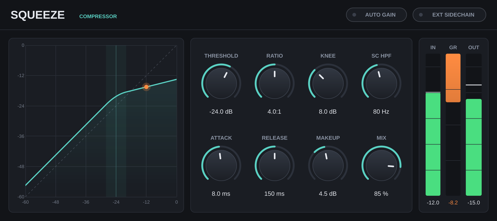

# Squeeze — compressor plugin (VST3 / AU)



Squeeze is a clean, zero-latency feed-forward compressor built with [JUCE 8](https://juce.com).
It builds as **VST3** on Windows, macOS and Linux, and also as **Audio Unit** on macOS (for Logic / GarageBand).

## Controls

| Control | Range | What it does |
|---|---|---|
| Threshold | −60 … 0 dB | Level above which compression starts |
| Ratio | 1:1 … 20:1 | How hard signal above the threshold is reduced (20:1 is close to a limiter) |
| Knee | 0 … 24 dB | Width of the soft transition around the threshold (0 = hard knee) |
| SC HPF | Off … 500 Hz | High-pass filter on the detector only, so bass doesn't trigger pumping. The audio itself is not filtered |
| Attack | 0.1 … 200 ms | How fast gain reduction kicks in |
| Release | 5 ms … 2 s | How fast it recovers |
| Makeup | −12 … +24 dB | Output gain applied to the compressed signal |
| Mix | 0 … 100 % | Dry/wet blend for parallel ("New York") compression. 0 % is bit-identical to the input |
| Auto Gain | on/off | Sets makeup automatically from threshold and ratio (replaces the Makeup knob) |
| Ext Sidechain | on/off | Detect from the plugin's sidechain input, e.g. kick ducking a bass |

The display shows the transfer curve (input vs output level) with a dot for the current input level, and IN / GR (gain reduction) / OUT meters.
Double-click any knob to reset it; click a value to type one in (`1.2 s`, `250 ms`, `off`, and so on all work).

**How it works:** a stereo-linked peak detector feeds a soft-knee gain computer. Attack and release smoothing run in the dB domain, which gives exact time constants (attack and release are the time to cover 63 % of the change). Makeup and mix are smoothed so automation doesn't click. The design follows Giannoulis, Massberg & Reiss, *Digital Dynamic Range Compressor Design* (JAES, 2012).

## Getting the plugin

**On Linux** you can use the ready-built VST3 in `prebuilt/Linux/` (x86-64). On Windows and macOS, use option A or B below.

### Option A: let GitHub build it (no tools needed)
1. Create a GitHub repository and upload this folder (keep the `.github` folder).
2. Open the repo's **Actions** tab. The *Build plugin* workflow runs automatically on every push.
3. When it finishes, download **Squeeze-Windows**, **Squeeze-macOS** or **Squeeze-Linux** from the run's *Artifacts* section.

### Option B: build it yourself
You need **CMake 3.22+**, **Git** and a C++17 compiler:
- **Windows:** Visual Studio 2022 (Community is free) with the *Desktop development with C++* workload
- **macOS:** Xcode, or its command line tools (`xcode-select --install`)
- **Linux:** GCC or Clang plus
  `sudo apt install libasound2-dev libx11-dev libxcomposite-dev libxcursor-dev libxext-dev libxinerama-dev libxrandr-dev libxrender-dev libfreetype-dev libfontconfig1-dev libgl1-mesa-dev`

Then, from this folder:

```bash
cmake -S . -B build -DCMAKE_BUILD_TYPE=Release
cmake --build build --config Release --parallel
```

JUCE is downloaded automatically the first time you configure, which takes a minute or two.
The plugin ends up in `build/Squeeze_artefacts/Release/VST3/Squeeze.vst3` (and `.../AU/Squeeze.component` on a Mac).

For a universal Mac binary (Apple Silicon and Intel), add `"-DCMAKE_OSX_ARCHITECTURES=arm64;x86_64"` to the first command.
Add `-DSQUEEZE_COPY_AFTER_BUILD=ON` to copy the plugin into your plugin folder automatically after each build (on Windows this needs an Administrator terminal).

## Installing

Copy the whole `Squeeze.vst3` folder (it's a bundle, not one file) to:

| OS | VST3 folder |
|---|---|
| Windows | `C:\Program Files\Common Files\VST3\` |
| macOS | `~/Library/Audio/Plug-Ins/VST3/` (AU: `~/Library/Audio/Plug-Ins/Components/`) |
| Linux | `~/.vst3/` |

Then rescan plugins in your DAW. Squeeze shows up under **Squeeze Audio → Squeeze** in the Dynamics category.

**macOS note:** plugins you built yourself or downloaded from GitHub Actions aren't code-signed. If your DAW refuses to load it, run
`xattr -cr ~/Library/Audio/Plug-Ins/VST3/Squeeze.vst3` (and the same for the `.component`).

**Using the sidechain:** route a track into Squeeze's sidechain input in your DAW, then switch on **EXT SIDECHAIN**.
If the switch is on but nothing is routed, Squeeze falls back to detecting from its main input.

## Testing

```bash
cmake -S . -B build -DCMAKE_BUILD_TYPE=Release -DSQUEEZE_BUILD_TESTS=ON
cmake --build build --config Release --parallel
./build/SqueezeTests_artefacts/Release/SqueezeTests build/Squeeze_artefacts/Release/VST3/Squeeze.vst3 ui.png
```

The test tool loads the built VST3 the way a DAW does and checks it against the maths: the hard- and soft-knee curves, the 20:1 ratio, attack and release time constants, the mix null test, manual and auto makeup, the sidechain filter, the external sidechain, and state recall. It then renders the UI to `ui.png`.
The plugin also passes [pluginval](https://github.com/Tracktion/pluginval) at strictness level 10.

## Code layout

```
Source/CompressorDSP.h      the compressor itself: plain C++ with no JUCE dependency, so it's easy to reuse
Source/PluginProcessor.*    parameters, buses (main + sidechain), state save/load
Source/PluginEditor.*       UI layout
Source/UI.h                 look and feel, transfer-curve display, meters
tests/PluginTests.cpp       host-based test tool
```

## Making it yours

To rename the plugin, change `COMPANY_NAME`, `PRODUCT_NAME`, `BUNDLE_ID`, `PLUGIN_MANUFACTURER_CODE` and `PLUGIN_CODE` in `CMakeLists.txt`.
The two codes are 4 characters each, and the manufacturer code needs at least one capital letter.
Give each plugin you release its own plugin code.

## License

JUCE is dual-licensed: AGPLv3, or a commercial license (with a free tier for small developers).
If you distribute this plugin, check that you follow the terms of one of them; see [juce.com/get-juce](https://juce.com/get-juce).
